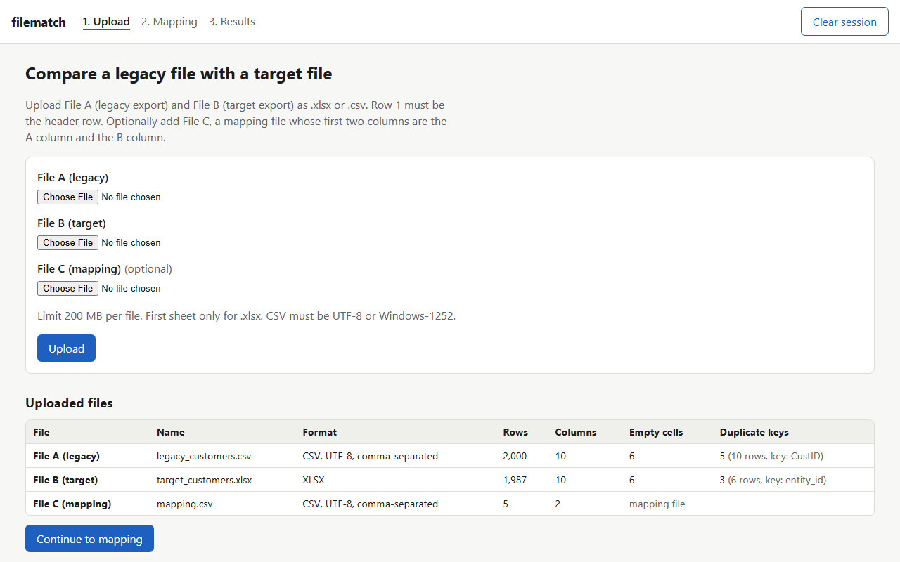
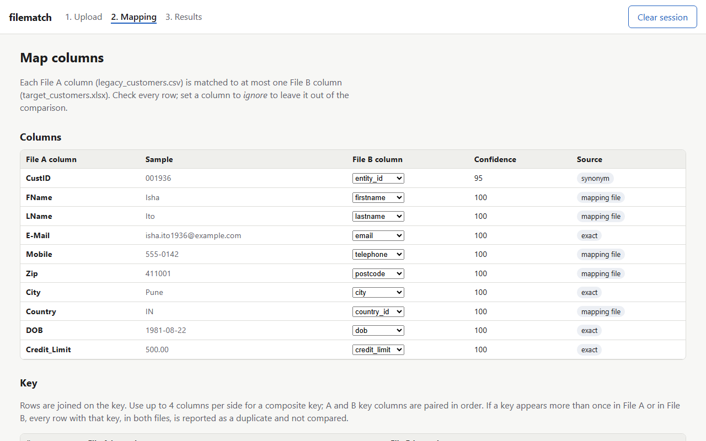
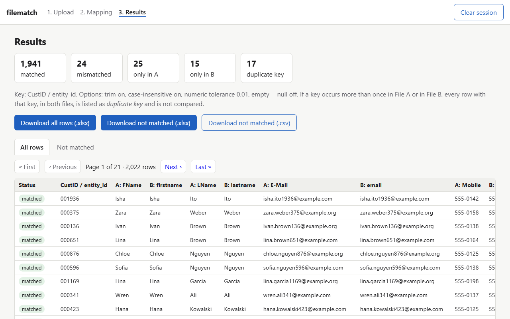
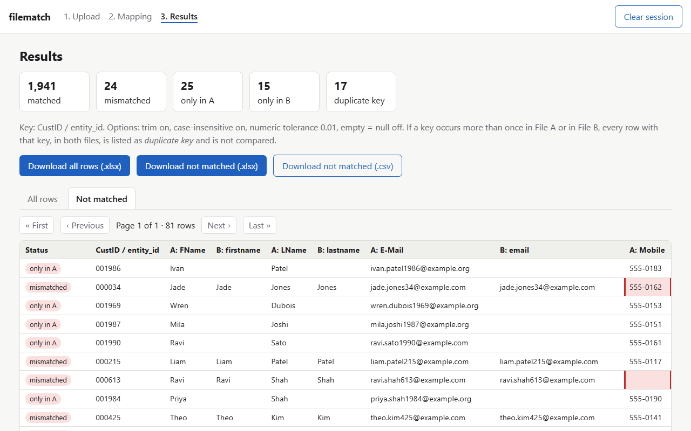

# filematch

Local-first tool to compare legacy vs target Excel/CSV files for data-migration QA: column mapping, key-based diff, Excel report with mismatches highlighted.

## Who it's for

People who check data migrations. You have an export from the old system (File A, legacy) and an export from the new one (File B, target): customers, products, orders. The columns are similar but not the same. filematch lines up the columns, joins the rows on a key, and tells you which rows match, which differ (and in which cells), which exist on only one side, and which keys are duplicated.

It runs in your browser against a server on your own machine. Nothing is uploaded anywhere.

## Screenshots

Captured with `scripts/screenshots.py` on the bundled fake demo data, with `demo/mapping.csv` as File C. The script compares with these options:

- **trim whitespace: on**
- **case-insensitive: on**
- **numeric tolerance: 0.01**
- **treat empty and null as equal: off**

That gives 1,941 matched, 24 mismatched, 25 only in A, 15 only in B and 17 duplicate key: 2,022 rows in all, 81 of them not matched. The 24 mismatched rows are the 18 planted real differences plus the 6 planted empty-vs-null cells, which stay mismatched because that option is off.

| Upload and file counts | Mapping |
|---|---|
|  |  |
| File A: 2,000 rows, 5 duplicate keys (10 rows). File B: 1,987 rows, 3 duplicate keys (6 rows). File C: 5 mapping pairs. | Five pairs come from the mapping file, the rest are exact or synonym matches. The options above are set further down this page, below the part shown. |
| **Results: all rows** | **Results: not matched** |
|  |  |
| Options: trim on, case-insensitive on, tolerance 0.01, empty = null off. 2,022 rows: 1,941 matched, 24 mismatched, 25 only in A, 15 only in B, 17 duplicate key. | Same options. 81 rows: 24 mismatched + 25 only in A + 15 only in B + 17 duplicate key. |

For comparison, on the same demo data: with every option at its default (all off, tolerance 0) there are 46 mismatched and 103 not-matched rows; with all four options on there are 18 mismatched and 75 not-matched rows. `demo/expected.json` holds both sets of counts and the integration test checks them.

## Quick start

Requires Python 3.11 or newer.

```bash
git clone https://github.com/jigar48/filematch.git
cd filematch
pip install .
filematch
```

Open http://127.0.0.1:8765/. Use `filematch --port 9000` for another port. To try it straight away, upload `demo/legacy_customers.csv` as File A, `demo/target_customers.xlsx` as File B and, optionally, `demo/mapping.csv` as File C.

## Docker

```bash
docker build -t filematch .
docker run --rm -p 127.0.0.1:8765:8765 filematch
```

The image runs as a non-root user and sets `FILEMATCH_HOST=0.0.0.0` inside the container so the port mapping works. Keep the `127.0.0.1:` prefix in `-p` so the app is reachable only from your own machine.

Docker was not available on the machine where this release was prepared, so these two commands were not run locally. The CI `docker` job builds the image, starts the container with the same `-p` mapping, fetches the upload page with curl, and checks that the process runs as the non-root user.

## How it works

1. **Upload.** File A (legacy) and File B (target), `.xlsx` or `.csv`, plus an optional File C (mapping file). Row 1 is the header row. Every value is read as text, so `007` stays `007`. CSV files are decoded as UTF-8 (BOM-aware) or, failing that, Windows-1252; the delimiter is detected among `,` `;` tab and `|`. For `.xlsx`, only the first sheet is read. The upload screen shows rows, columns, empty cells and duplicate keys (on the first column) for each file. These per-file counts look at one file at a time; a key repeated in only one file still makes that key's rows in the other file duplicate key when you compare.
2. **Mapping.** Each A column is matched to at most one B column, with a confidence from 0 to 100 and a source:
   - **exact**: equal after normalising (lowercase, trim, camelCase split, `_ - .` and spaces treated as one separator), so `E-Mail` = `email`;
   - **synonym**: in the same small built-in group, e.g. `FName` / `firstname`, `Zip` / `postcode`, `CustID` / `entity_id`;
   - **fuzzy**: rapidfuzz `token_sort_ratio` on the normalised names, suggested only at 60 or above;
   - **mapping file**: pairs from File C (first column = A name, second = B name), which take precedence over everything else;
   - **AI**: optional, see below.

   Pairs are assigned greedily one to one: mapping file, then exact, synonym, AI and fuzzy, then highest score. You can change any row with its dropdown or set it to *ignore*.
3. **Key.** By default the first column of each file. You can choose a composite key of up to 4 columns per side; A and B key columns are paired in order.
4. **Options** (all off by default):
   - *trim whitespace* and *case-insensitive* (both also apply to key values);
   - *numeric tolerance* (absolute). When both values parse as numbers they are always compared as numbers, even at tolerance 0, so `1` equals `1.0`;
   - *treat empty and null as equal*. An empty CSV field is an empty string, and an empty Excel cell is null.
5. **Row classes.**
   - **matched**: key found on both sides and every mapped column is equal;
   - **mismatched**: key found on both sides and at least one mapped column differs;
   - **only in A** / **only in B**: the key is absent from the other file;
   - **duplicate key**: the key is *ambiguous*, meaning it occurs more than once in File A **or** more than once in File B. Every row with an ambiguous key, in **both** files, is listed as a duplicate and is **not** joined or compared, so a repeated key cannot multiply rows. For example, a key that appears twice in A and once in B gives three duplicate-key rows (two from A, one from B) and no *only in* rows. The status column shows which file each duplicate row comes from.
6. **Results.** Two tabs: all rows side by side, and every row that is not matched, with a status column. Pages hold 100 rows. Mismatched cells are red and carry a hidden "Mismatch:" label for screen readers. Downloads: both tabs as `.xlsx` (header frozen, autofilter on, both the A and the B cell of a mismatch filled red) and the not-matched tab as CSV (UTF-8 with BOM). If a tab has more rows than Excel allows (1,048,576 including the header), the `.xlsx` download is refused and a CSV is offered instead.

## AI suggestions

This feature is opt-in and off unless both of these are true:

1. the server was started with `ANTHROPIC_API_KEY` set in its environment, and the extra is installed: `pip install ".[ai]"`;
2. you click **Suggest with AI** on the mapping screen, read the preview, and click **Send and suggest**.

The preview page shows the exact message that will be sent: the instructions, every header name from File A and File B, and up to 5 distinct non-empty sample values per column, each cut to 50 characters. Nothing else from your files is sent. The model is `claude-haiku-5-5` unless you set `FILEMATCH_AI_MODEL`. The response must be JSON and is parsed strictly; pairs that name unknown columns are dropped, and the request times out after 30 seconds. On any error you keep the automatic suggestions and see a short message. The key is read only from the server environment. It is never accepted from the browser, logged, or written to disk.

**Sample values may contain personal data** (names, emails, phone numbers). Only use this if you are allowed to send those samples to the API provider.

## Privacy

- Your files stay on your machine. Each browser session gets its own temp directory (`filematch-*` in your system temp folder). The directory is deleted when you click **Clear session**, after 60 minutes without activity, and when the app shuts down.
- The app makes no network calls of its own: no telemetry, no update checks, no CDN assets.
- The only thing that can ever leave your machine is the header-and-sample AI request described above, and only when you set a key and click the button.

## Security notes

- Upload limit of 200 MB per file (`FILEMATCH_MAX_UPLOAD_MB`), enforced while the request streams in, not after.
- Type checks by extension and content. `.xlsx` must be a zip containing `[Content_Types].xml`; `.xls`, `.xlsm` and workbooks with macros are rejected. `.csv` must decode as UTF-8 or Windows-1252 and contain no NUL bytes.
- Zip-bomb guard: an `.xlsx` that would unpack to more than 1 GB, or that has a compression ratio above 100:1, is rejected. At most 500 columns per file.
- Jinja2 autoescaping is on for every template. Responses carry `Content-Security-Policy: default-src 'self'`, `X-Content-Type-Options: nosniff` and `Referrer-Policy: no-referrer`. The pages use no inline scripts or styles.
- Host header check (localhost, 127.0.0.1, ::1) against DNS rebinding. The session cookie is random, HttpOnly and SameSite=Strict.
- **Formula injection on export.** In `.xlsx` files, `strings_to_formulas` is off and every source value is written with `write_string`, so text such as `=HYPERLINK(...)` is stored as text, not as a formula. In the CSV, any text value starting with `=`, `+`, `-`, `@`, a tab or a carriage return gets a leading `'`, unless the value is a plain number such as `-5` or `+1.5`.

## Performance

Measured with `python scripts/bench.py`: a synthetic pair of 500,000 rows x 10 columns (File A as CSV, File B as XLSX) with about 1% of rows changed. Each step was run 3 times; the table shows the median.

| Step | Median (s) |
|---|---:|
| Read A (44.8 MB CSV) | 0.15 |
| Read B (28.0 MB XLSX) | 6.41 |
| Compare, including the Parquet write | 0.39 |
| First results page (100 rows) | 0.02 |
| XLSX export, tab (b) not matched (5,000 rows) | 1.26 |
| XLSX export, tab (a) all rows (500,000 rows) | 116.95 |

Result: 495,000 matched and 5,000 mismatched rows.

Machine: Intel Core Ultra 9 285H (16 cores / 16 threads), 31.4 GB RAM, Windows 11 Home (build 26300), Python 3.13.9, Polars 2.1.0.

The full-table xlsx export is the slow step: it writes about 10 million cells one at a time through xlsxwriter. For large files, export the not-matched tab or use the CSV.

## Limitations

- Tested only on fake, generated data.
- Dates are compared as text, so format differences (`2024-01-31` vs `31/01/2024`) show up as mismatches.
- Only the first sheet of an `.xlsx` file is read.
- CSV files must be UTF-8 or Windows-1252.
- Rows with an ambiguous key (repeated in either file) are listed as duplicate key in both files but not compared.
- In mapped value columns, values that both parse as numbers are compared as numbers, so `007` and `7` count as equal there. Key values are always matched as text, so leading zeros in keys are kept.
- Built as a single-user local tool. It keeps sessions in memory in one process. Do not expose it on a network.
- AI and fuzzy suggestions can be wrong. Review every mapping before you compare.

## Development

```bash
pip install -e ".[dev,ai]"
pytest
ruff check . && ruff format --check .
python scripts/make_demo.py      # regenerate demo/ (deterministic)
python scripts/bench.py          # benchmark
python -m playwright install chromium && python scripts/screenshots.py
```

## Related tools

- [datacompy](https://github.com/capitalone/datacompy): a Python library for comparing two DataFrames (pandas, Spark, Polars and others) and reporting the differences.
- [Datafold](https://www.datafold.com/): a commercial platform for data diffing across databases and warehouses, aimed at data-engineering teams.

## License

MIT. See [LICENSE](LICENSE). Copyright (c) 2026 Jigar Prajapati.

## Support my work

If this tool saved you time, buy me a coffee.

<a href="https://buymeacoffee.com/buildwithjigar"></a>
